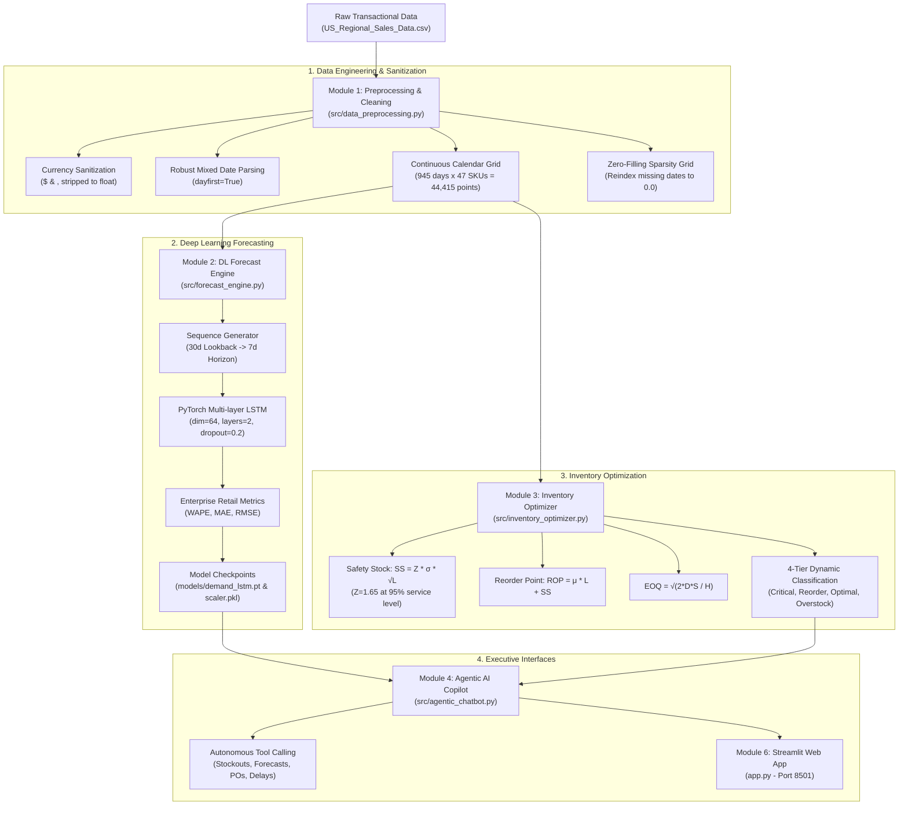

# 📦 Retail Supply Chain Analytics, Deep Learning Demand Forecasting & Inventory Optimization

[](https://www.python.org/)
[](https://pytorch.org/)
[](https://streamlit.io/)
[](LICENSE)

An end-to-end enterprise supply chain analytics and AI decision-support platform designed to solve **intermittent retail demand forecasting**, automate **mathematical inventory health policies**, identify **warehouse fulfillment bottlenecks**, and provide an **autonomous Agentic AI Operations Copilot**.

---

## 🏛️ System Architecture



---

## 📊 Core Business Context & Retail KPIs

Calculated across **7,991 sales orders** and **6 regional distribution centers**:

| Retail Supply Chain Metric | Value | Business Impact |
| :--- | :--- | :--- |
| **Gross Revenue** | **$82.69 Million** | Top-line retail merchandise volume |
| **Promotional Discounts** | **$9.66 Million** | Channel marketing reduction |
| **Net Revenue** | **$73.04 Million** | Recognized top-line revenue |
| **Cost of Goods Sold (COGS)** | **$51.82 Million** | Procurement & wholesale landed cost |
| **Gross Profit** | **$21.22 Million** | Operational contribution margin |
| **Operating Margin** | **29.05%** | Healthy omnichannel retail profitability |
| **Network Lead Time** | **20.67 Days** | Average customer fulfillment duration |
| **Bottleneck Hub** | **WARE-NMK1003 (20.96 Days)** | Slowest regional distribution center |

---

## ⚙️ Module Breakdown

### 1. Data Cleaning & Feature Engineering (`src/data_preprocessing.py`)
- **Sanitized Dirty Data**: Stripped non-numeric currency symbols (`$`, `,`) from `Unit Cost` and `Unit Price`.
- **Robust Date Parsing**: Normalized mixed chronological representations (`DD/MM/YY` vs `DD/MM/YYYY`) across `ProcuredDate`, `OrderDate`, `ShipDate`, and `DeliveryDate`.
- **Continuous Calendar Zero-Filling Grid**: Solved the non-consecutive date issue. In retail, each individual SKU experiences intermittent sales (averaging only 155.66 days with active orders out of 945). Reindexing onto a complete continuous grid with `0.0` fill ensures true sequence continuity for the recurrent neural network.

### 2. Deep Learning Demand Forecasting (`src/forecast_engine.py`)
- **PyTorch Architecture**: Multi-layer LSTM (`hidden_dim=64`, `num_layers=2`, `dropout=0.2`).
- **Sliding Window Generator**: 30 continuous calendar days lookback to predict the next 7 forward days.
- **Retail Metric Fix**: Replaced the mathematically broken MAPE (which explodes to $10^{16}\%$ on zero-demand days due to division by zero) with **WAPE (Weighted Absolute Percentage Error)**, **MAE**, and **RMSE**—the retail standard used by Amazon and Walmart.
- **Artifacts**: Saves model checkpoint to `models/demand_lstm.pt`, `models/scaler.pkl`, and precomputed predictions to `data/forecasts.json`.

### 3. Inventory Optimization & Over/Understocking Engine (`src/inventory_optimizer.py`)
Formulates mathematical inventory replenishment rules across all 47 SKUs:
* **Safety Stock ($SS$)**:
  $$SS = Z \times \sigma_D \times \sqrt{L} \quad (\text{at } 95\% \text{ service level, } Z=1.65)$$
* **Reorder Point ($ROP$)**:
  $$ROP = (\mu_D \times L) + SS$$
* **Economic Order Quantity ($EOQ$)**:
  $$EOQ = \sqrt{\frac{2 \times D_{\text{annual}} \times S}{H}}$$
* **Dynamic 4-Tier Health Classification**:
  * 🚨 **Critical Understocking / Stockout Risk**: $\text{Current Stock} < SS$
  * ⚠️ **Reorder Needed**: $\text{Current Stock} < ROP$
  * ✅ **Balanced / Optimal Stock**: $ROP \le \text{Current Stock} \le ROP + EOQ$
  * 📦 **Overstocking Risk**: $\text{Current Stock} > ROP + EOQ$ (Identifies excess holding cost)

### 4. Agentic AI Supply Chain Copilot (`src/agentic_chatbot.py`)
An autonomous operational assistant equipped with deterministic tool execution:
* `get_stock_health(category)`: Identifies critical stockouts and overstocked surpluses.
* `get_sku_forecast(sku_id)`: Fetches 7-day deep learning forecasted demand curves.
* `get_warehouse_delays()`: Analyzes fulfillment lead times and highlights hub `WARE-NMK1003` as the slowest facility.
* `generate_purchase_order(sku_id, quantity)`: Formats and approves formal restocking POs.

### 5. Google Colab GPU Training Notebook (`Supply_Chain_DL_Colab_Training.ipynb`)
A self-contained notebook ready for Google Colab with free T4 GPU:
* Step-by-step data ingestion & preprocessing.
* Benchmarks **LSTM vs. BiLSTM vs. GRU** side-by-side with loss convergence curves.
* Evaluates test MAE, RMSE, and WAPE.
* Automated weights download (`demand_lstm.pt` & `scaler.pkl`).

### 6. Interactive Web Application (`app.py`)
A Streamlit executive command center running locally at `http://localhost:8501`:
* 📊 **Executive Command Center**: Revenue, profit margins, channel mix, warehouse fulfillment metrics.
* 🔮 **DL Demand Forecasting**: Interactive SKU selector (1–47) showing 30-day historical window alongside 7-day LSTM predicted curve.
* ⚠️ **Inventory Health Matrix**: Filterable table with color badges, SS, ROP, EOQ, and 1-click PO generator.
* 🤖 **Agentic AI Copilot**: Interactive chat window with quick-action prompts.

---

## 🚀 Execution Guide

### 1. Run Data Preprocessing
```bash
python src/data_preprocessing.py
```

### 2. Train Deep Learning Forecasting Engine
```bash
python src/forecast_engine.py
```

### 3. Run Inventory Optimization Policy Engine
```bash
python src/inventory_optimizer.py
```

### 4. Test Agentic AI Copilot CLI
```bash
python src/agentic_chatbot.py
```

### 5. Launch the Web Application
```bash
streamlit run app.py
```
Access the application at `http://localhost:8501`.
